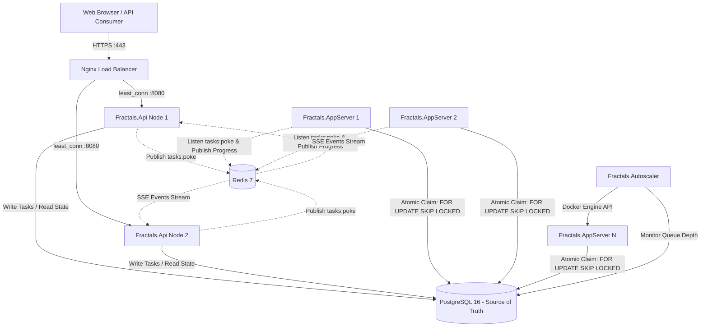
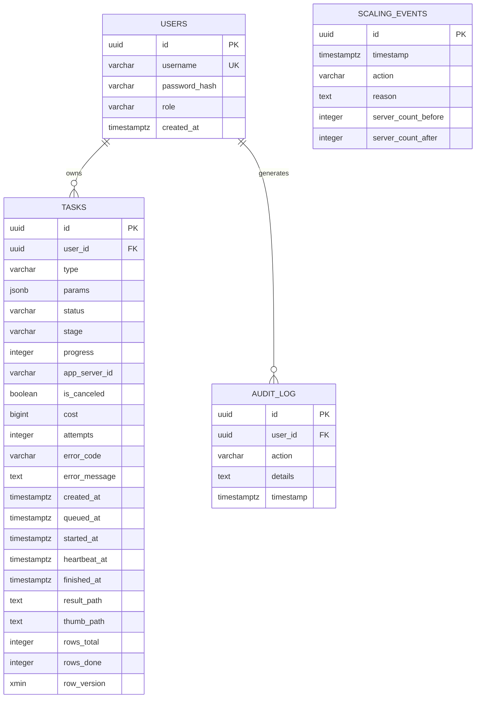

# Архітектура розподіленої системи генерації фракталів

## 1. Загальний огляд системи

Система є розподіленим комплексом для виконання ресурсомістких математичних обчислень (генерація фракталів Мандельброта та Жюліа) з горизонтальним масштабуванням, дворівневим балансуванням навантаження та відмовостійкістю.



---

## 2. Потік виконання задачі (Step-by-Step Flow)

1. **Створення задачі**:
   - Клієнт формує параметри фрактала (тип, розміри, ітерації, палітра, координати).
   - Клієнтська сторона проводить миттєву валідацію лімітів та оцінює трудомісткість $Cost = Width \times Height \times MaxIterations$.
   - Запит надсилається через `POST /api/tasks` (захищений авторизацією).
2. **Обробка у Web-шарі (`Fractals.Api`)**:
   - Nginx балансує запит між `api1` та `api2` алгоритмом `least_conn`.
   - Middleware фіксує та повертає заголовок `X-Served-By: <api-instance-id>`.
   - FluentValidation перевіряє ліміти: відхиляє з кодом 422 у разі перевищення $MaxCost$, розмірів або активних задач.
   - Атомарно в транзакції PostgreSQL створюється запис у таблиці `tasks` зі статусом `Queued` та `app_server_id = NULL`.
   - Після успішного `COMMIT` публікується легковаговий сигнал у Redis: `PUBLISH tasks:poke`.
   - Клієнту повертається `202 Accepted` з ідентифікатором задачі та її позицією в черзі.
3. **Захоплення задачі App-сервером (`Fractals.AppServer`)**:
   - Вільний воркер, отримавши поштовх із Redis (або за черговим тактом fallback-таймера), виконує атомарний SQL-запит:
     ```sql
     UPDATE tasks
     SET status = 'Running',
         stage = 'Обчислення рядків',
         app_server_id = @myId,
         started_at = NOW(),
         heartbeat_at = NOW(),
         attempts = attempts + 1
     WHERE id = (
         SELECT id FROM tasks
         WHERE status = 'Queued' AND app_server_id IS NULL AND is_canceled = false
         ORDER BY created_at, id
         FOR UPDATE SKIP LOCKED
         LIMIT 1
     )
     RETURNING *;
     ```
   - Завдяки `FOR UPDATE SKIP LOCKED` два сервери гарантовано ніколи не отримають одну задачу.
4. **Обчислення та моніторинг прогресу**:
   - Обчислення здійснюється смугами (наприклад, по 64 рядки) за допомогою `Parallel.For` у межах виділеного ліміту ядер.
   - Перед кожною смугою та всередині рядків перевіряється `CancellationToken` та прапорець `is_canceled` у БД/Redis.
   - Під час рендерингу воркер оновлює `progress`, `rows_done` та `heartbeat_at` у БД (із тротлінгом ~1 раз на секунду) та транслює подію прогресу в Redis Pub/Sub.
   - Клієнт отримує оновлення в реальному часі через Server-Sent Events (`GET /api/tasks/{id}/events`).
5. **Фіналізація**:
   - Після обчислення всіх смуг статус змінюється на `Assembling`, генерується повнорозмірний PNG та мініатюра (thumbnail).
   - Файли зберігаються у спільний том `/app/storage`.
   - Статус переводиться в `Success`, `progress = 100`, фіксується час завершення.

---

## 3. ER-діаграма бази даних



---

## 4. Обґрунтування ключових архітектурних рішень

### Чому PostgreSQL як черга + `FOR UPDATE SKIP LOCKED`?
1. **Точність та консистентність**: Вимога викладача чітко визначає БД як єдине джерело істини. Окремі брокери повідомлень (RabbitMQ, Kafka) створюють ризик розсинхронізації стану («в черзі є, в базі немає» або навпаки).
2. **`SKIP LOCKED`**: Механізм PostgreSQL дозволяє паралельним процесам миттєво захоплювати вільні записи без блокування сусідніх транзакцій, усуваючи змагання (race conditions) без накладних витрат на складні розподілені замки.
3. **Легкість підтримки**: Відсутність зайвих важких компонентів черг зменшує вимоги до інфраструктури.

### Чому Redis для поштовхів та SSE, а не як персистентне сховище?
1. Втрата або перезапуск Redis не призводить до втрати завдань, оскільки всі завдання надійно збережені в PostgreSQL з індексом по `status = 'Queued'`.
2. Redis ідеально підходить для високонавантаженого Pub/Sub обміну подіями прогресу та відправки SSE клієнтам на обидва API-інстанси.

### Чому відмова від Celery / Hangfire?
1. .NET 8 надає вбудовану, нативну абстракцію `BackgroundService` з `PeriodicTimer` та семафорами `SemaphoreSlim`.
2. Celery — інструмент зі світу Python. Hangfire вимагає додаткових таблиць, важких міграцій і ліцензійних обмежень для pro-можливостей, тоді як нативна реалізація повністю прозора, контрольована та не має сторонніх прихованих залежностей.

### Чому алгоритм балансування Nginx `least_conn`?
Запити до API можуть відрізнятися за часом обробки (наприклад, тривале утримання SSE-з'єднання або завантаження важкого PNG проти швидкого отримання статусу). Алгоритм `least_conn` (найменша кількість активних з'єднань) на відміну від `round-robin` враховує реальне навантаження на кожен інстанс Kestrel і не перевантажує ноду довгоживучими стрімами.
