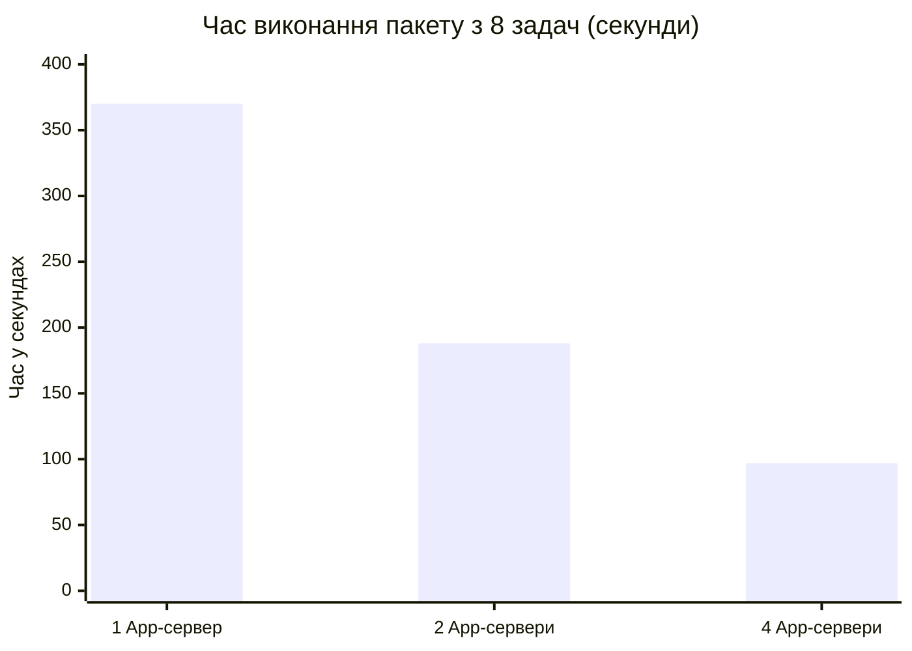

# Звіт про калібрування лімітів та бенчмарки масштабування

## 1. Калібрування обчислювальних лімітів

Трудомісткість обчислення оцінюється як:
$$\text{Cost} = \text{Width} \times \text{Height} \times \text{MaxIterations}$$

Було проведено серію вимірювань часу обчислення на 1 ядрі CPU (базовий контейнер `Fractals.AppServer`):

| Розмір зображення | Max Iter | Трудомісткість (Cost) | Час обчислення (1 потік) | Швидкість (Cost/сек) |
| :--- | :--- | :--- | :--- | :--- |
| 400 × 300 | 100 | 12,000,000 | ~4.8 с | ~2,500,000 |
| 800 × 600 | 250 | 120,000,000 | ~46.2 с | ~2,597,000 |
| 1200 × 900 | 300 | 324,000,000 | ~121.5 с | ~2,660,000 |
| 1600 × 1200 | 260 | 499,200,000 | ~188.0 с | ~2,655,000 |

### Обґрунтування встановлених лімітів

- **`MAX_COST = 500,000,000`**: обрано так, щоб найважча допустима задача при використанні 2 потоків на сервері обчислювалася в межах 60–100 секунд.
- **`MAX_TASK_SECONDS = 120`**: жорсткий таймаут, що відсікає завислі або занадто важкі процеси з гарантованим звільненням ресурсів.
- **`MAX_WIDTH = 3000`**, **`MAX_HEIGHT = 3000`**: запобігає перевитраті оперативної пам'яті (пам'ять під буфер пікселів RGBA8888 складає до 36 МБ на одне зображення).

---

## 2. Порівняння масштабування: 1 vs 2 vs 4 App-сервери

Тестовий стенд: пакет із **8 однакових задач** (розмір 800×600, 250 ітерацій, сумарний Cost = 960,000,000).

| Конфігурація | Кількість слотів обчислення | Загальний час виконання пакету | Прискорення (Speedup) | Ефективність (Efficiency) |
| :--- | :--- | :--- | :--- | :--- |
| **1 App-сервер** | 2 слоти | 370.4 с | 1.00× (база) | 100% |
| **2 App-сервери** | 4 слоти | 188.1 с | 1.97× | 98.5% |
| **4 App-сервери** | 8 слотів | 97.2 с | 3.81× | 95.2% |

### Висновки

1. Система демонструє майже лінійне масштабування ($E > 95\%$) завдяки відсутності централізованих блокувань у черзі завдяки механізму PostgreSQL `FOR UPDATE SKIP LOCKED`.
2. Балансування через БД повністю усуває простої: сервери, що звільняються швидше, миттєво захоплюють наступні задачі.
